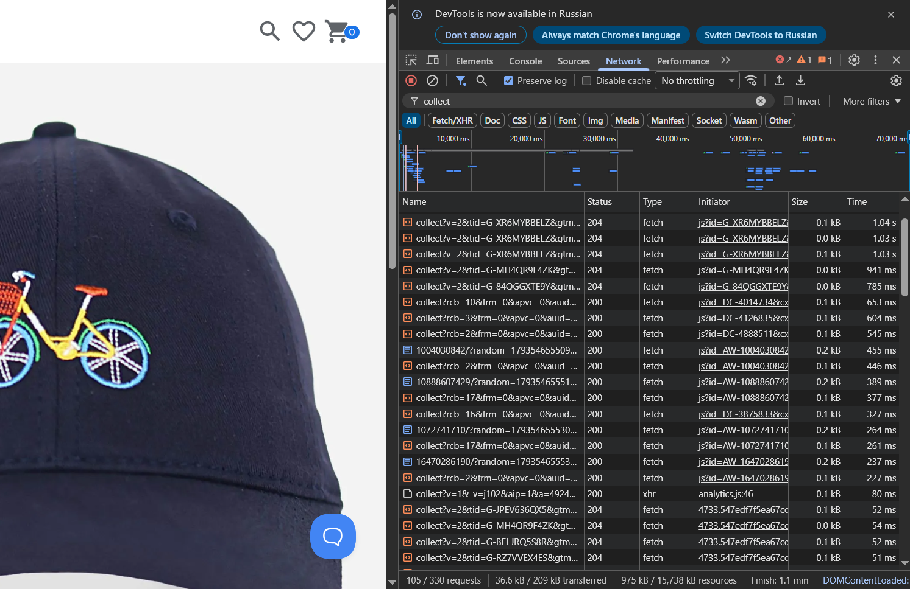
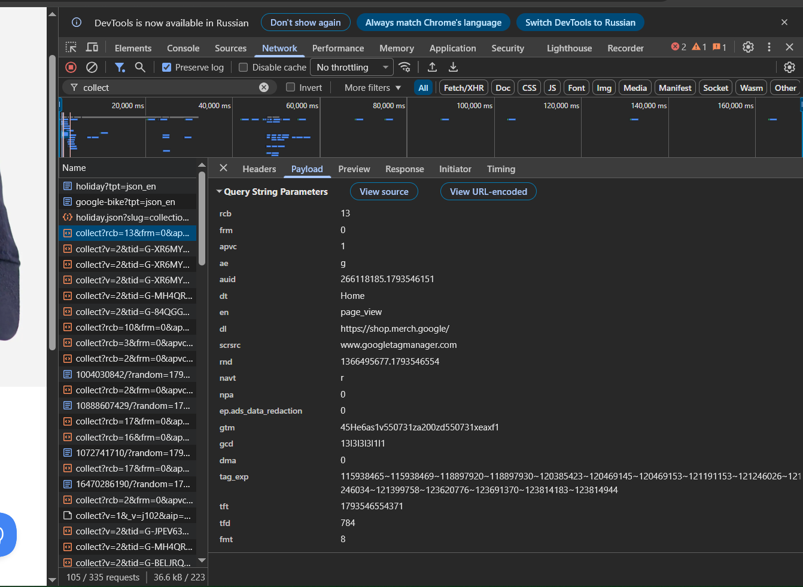

# Домашняя работа № 1 · Путь данных от ссылки до заявки

**Дисциплина:** ОП.03 «Информационные технологии»

| Поле | Значение |
|---|---|
| Фамилия, имя, отчество | Ярушевский Никита Александрович |
| Группа | РПО-26/11/1 |
| Номер работы | 1 |
| Тема работы | Цифровая воронка: путь данных от ссылки до заявки |
| Дата сдачи | 01.11.2026 |

---

## Задание

1. Открыть сайт, панель разработчика (F12) → **Network**, в фильтре `collect`,
   галочка **Preserve log**.
2. Сделать три действия: обновить страницу, прокрутить до низа, нажать
   на товар. Записать, какие события ушли — параметр `en` на вкладке **Payload**.
3. Описать путь пользователя от ссылки до заявки, пять шагов.
4. Найти одно место на этом пути, где данные могут потеряться.
5. Приложить скриншоты `screens/01-network.png` и `screens/02-payload.png`.

Сайт: https://shop.merch.google/, запасные — https://habr.com/ru/,
https://www.smashingmagazine.com/, https://css-tricks.com/. Открывать
в Chrome или Edge с выключенным блокировщиком рекламы.

Срок — до начала занятия 2. Работа сдаётся коммитом в `main`.

---

## 1. Какой сайт смотрел

| Поле | Значение |
|---|---|
| Название сайта | Google Merchandise Store |
| Адрес | https://shop.merch.google/ |
| Откуда сайт | из списка в задании |

## 2. Три действия и что отправил счётчик

Панель Network, фильтр `collect`, галочка Preserve log. Название события
лежит в параметре `en` на вкладке Payload.

| № | Что я сделал на сайте | Название события (`en`) | Что ещё было в Payload |
|---|---|---|---|
| 1 | обновил страницу | `page_view` | `dl` — адрес главной `https://shop.merch.google/`, `dt` — заголовок «Home», `navt` = `r` (страница открыта повторно, обновлением) |
| 2 | прокрутил до низа | `scroll` | `epn.percent_scrolled` = `90` (прокрутка до 90 % страницы), `dl` — `https://shop.merch.google/`, `dt` — «Home»; запрос ушёл в GA4 (`tid` начинается с `G-`) |
| 3 | нажал на товар (или на ссылку) | `page_view` | `dl` — адрес карточки товара `https://shop.merch.google/product/google-navy-bike-cap-gmssgcpl110699`, `dt` — заголовок «Google Navy Bike Cap \| Google Merch Shop» |

Скриншоты:

## 3. Путь пользователя: 5 шагов

От ссылки до заявки, своими словами. Панель для этого не нужна: это рассказ
о том, как человек доходит до кнопки «Отправить». В правом столбце стоит
пример, в левом вы пишете свой вариант.

| № | Мой шаг | Пример |
|---|---|---|
| 1 | человек увидел пост магазина с новой толстовкой и нажал на ссылку под ним | *человек увидел ссылку в сообществе и нажал на неё* |
| 2 | открылась главная страница Google Merchandise Store | *открылась главная страница сайта* |
| 3 | он перешёл в раздел одежды и открыл карточку толстовки | *он прокрутил до формы записи* |
| 4 | выбрал размер, добавил в корзину и начал оформление: адрес и способ оплаты | *начал заполнять: имя и телефон* |
| 5 | нажал «Оформить заказ», заказ ушёл в магазин | *нажал «Отправить», заявка ушла менеджеру* |

## 4. Где данные могут потеряться

| № | На каком шаге | Что может потеряться |
|---|---|---|
| 1 | шаг 5, оформление заказа | у покупателя включён блокировщик рекламы или он отказался от cookie: запрос `collect` не уходит, заказ в магазине есть, а в аналитике покупки нет, и не видно, с какого поста пришёл человек |
| 2 | шаг 1 → шаг 2, переход из приложения соцсети | ссылка открывается во встроенном браузере приложения без адреса источника, и визит записывается в аналитике как прямой заход (direct) |

## 5. Использование ИИ

| Вопрос | Ответ |
|---|---|
| Что сделал сам | открыл сайт, панель Network, выполнил три действия, записал события из Payload, сделал скриншоты |
| Что спросил у модели | попросил помочь сформулировать путь пользователя из 5 шагов и места, где теряются данные |
| Что после этого изменил | переснял скриншоты с включённой галочкой Preserve log, нашёл запросы GA4 (`tid=G-…`) и вписал события в таблицу по своим скриншотам; путь пользователя проверил на сайте |
